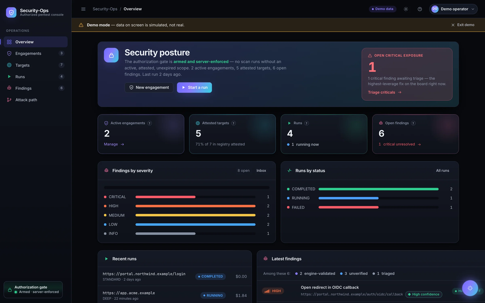
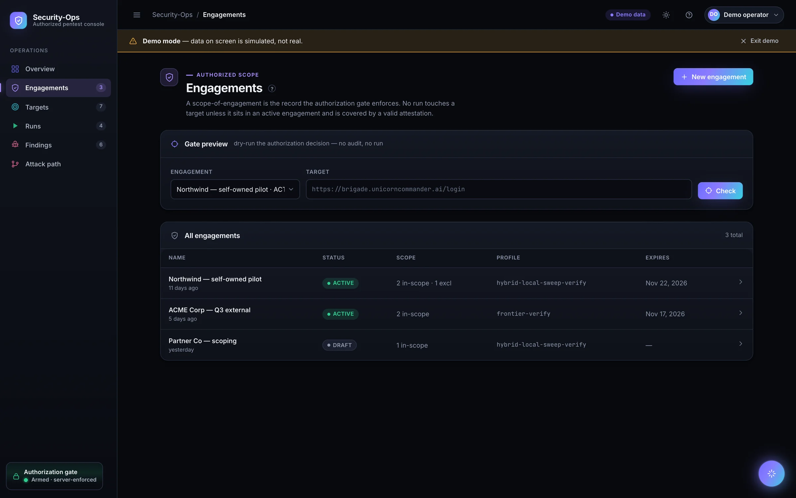
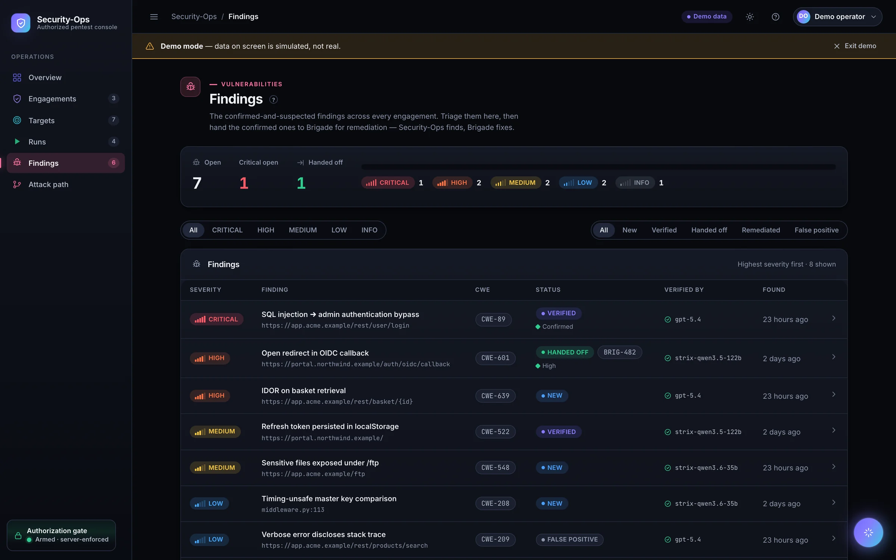
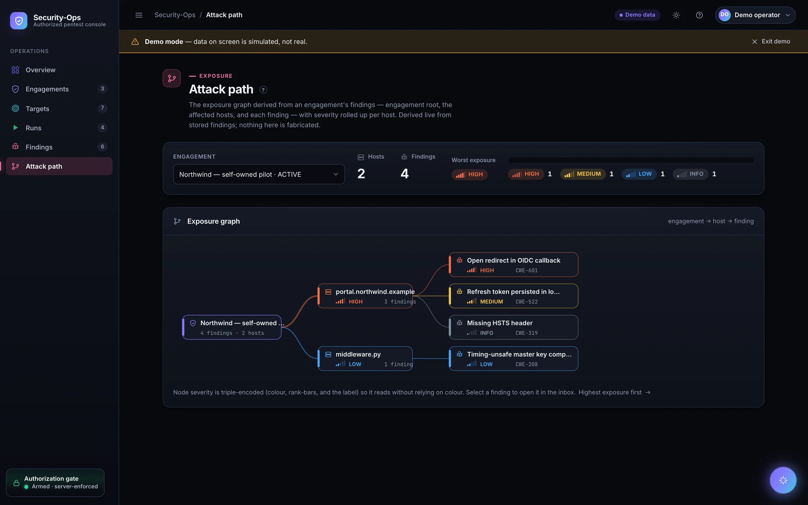
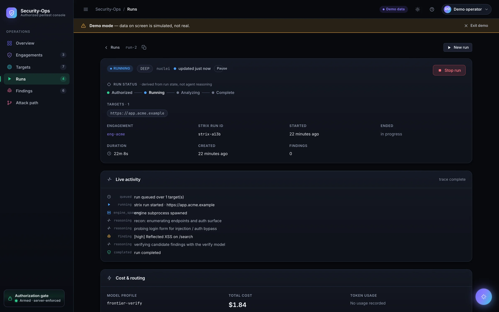
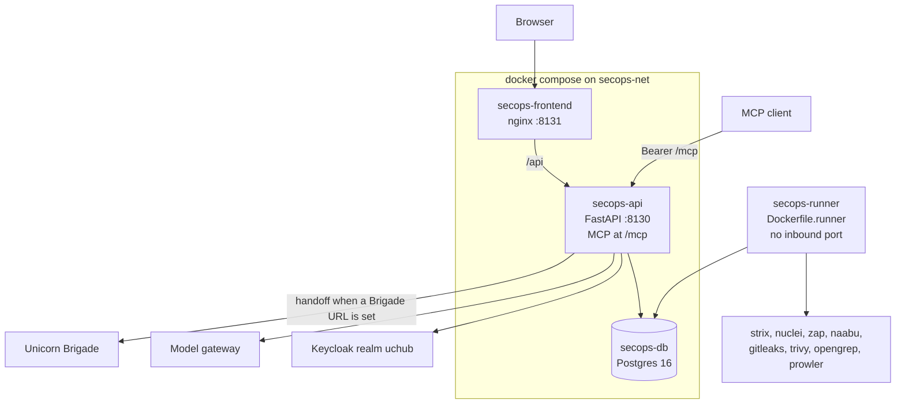

<div align="center">

# Security-Ops

Authorized penetration testing for the Unicorn Commander suite. A scan runs only when an engagement is active, the target is in scope, and a current attestation covers it.

[](LICENSE)
[](app/main.py)
[](Dockerfile)
[](requirements.txt)
[](docker-compose.yml)
[](docker-compose.yml)
[](app/mcp/server.py)

[Quick start](#quick-start) · [Features](#feature-tour) · [Agents](#built-for-agents) · [Architecture](#architecture) · [Suite](#part-of-unicorn-commander)

</div>

<p align="center">
  
</p>

## What is Security-Ops?

Security-Ops is a self-hosted console and API for **authorized** security testing. Operators and agents register a target, prove they may test it, open an engagement with an explicit scope, and only then start a scan. The same server-side gate applies to a person in the console and to an agent on the MCP server.

It wraps several scan engines, including the open-source [Strix](https://github.com/usestrix/strix) agent, in engagement records, attestation, a hash-chained audit log, and per-organization isolation. Findings can be triaged in the console and, when you configure it, handed to [Unicorn Brigade](https://github.com/Unicorn-Commander/Unicorn-Brigade) for remediation. Security-Ops shares the suite Keycloak realm with the rest of Unicorn Commander. It keeps its own database, network, and credentials.

> **Authorized testing only.** Point Security-Ops at systems you own or have written permission to test. The server refuses a run that fails the engagement, scope, or attestation checks. That refusal is the product, and it is not a suggestion to the scanner.

## Highlights

- **A server-side authorization gate.** `app.authz.gate.enforce_scope` runs before any run row is created. The engagement must be active, unexpired, inside its time window, and not emergency-stopped. The target must be in scope, not excluded, and covered by an attestation that is still valid. Each decision appends one audit row.
- **Attestation before a target is scannable.** External hosts are checked with a DNS TXT record, a file at a well-known path, or a response header. Self-owned assets can be attested in the console. Cloud accounts use an assume-role proof. Registration alone never authorizes a scan.
- **Eight engines, one gate.** Strix, Nuclei, ZAP, Naabu, Gitleaks, Trivy, Opengrep, and Prowler are selected per run. All of them pass through the same scope check, findings pipeline, and audit trail. See [docs/engines.md](docs/engines.md).
- **An audit log you can export.** Audit events form a SHA-256 hash chain (`prev_hash` → `event_hash`). `GET /api/v1/compliance` and `GET /api/v1/compliance/audit-events` expose that trail for the caller's organization.
- **Agents with the same rules as the console.** The MCP server exposes 25 tools over stateless streamable HTTP at `/mcp`. A tool that starts a run calls the same `start_run` path the HTTP API uses.
- **Two tenant boundaries.** Every business route resolves the caller's organization and filters on `org_id`. Postgres row-level security is forced on the sensitive tables, keyed to the session variable `app.current_org_id`. With no variable set, those policies match zero rows.
- **Stop switches.** An operator can emergency-stop one engagement or set `SECOPS_EMERGENCY_STOP_ALL` to deny every scan. A running engine is not trusted to notice the stop by itself: the server records it, and the runner watches the run row.
- **Triage stays with a person.** Findings move through new, verified, false positive, handed off, and remediated. The console assistant can explain the tenant and suggest the next click. It does not create engagements, attest targets, or start scans.

## Feature tour

### Engagements

<p align="center">
  
</p>

An engagement is the scope the gate enforces: in-scope rules, exclusions, a time window, intensity (`QUICK`, `STANDARD`, or `DEEP`), and a model profile. New engagements start as drafts. Activation fails closed unless every in-scope rule is covered by a currently valid attested target. The engagements screen can preview a target with a dry-run scope check (no audit write) and can export a branded report as Markdown or JSON.

`make seed` loads a pilot organization (`pilot`), attests the self-owned host `brigade.unicorncommander.ai`, activates an engagement for it, and shows the gate allow an in-scope URL and deny `https://example.com/`.

### Findings

<p align="center">
  
</p>

Findings are the vulnerabilities a run recorded: severity from info through critical, a status, an endpoint, evidence, and an optional proof. The same fingerprint is stored once. The Gitleaks and Trivy secret parsers drop the plaintext secret before it is written. A person can mark a finding verified, false positive, or remediated. Handing it to Brigade is a separate action, and it is refused for a false positive.

When `SECOPS_ENRICHMENT_ENABLED` is on (the default), CVE findings are enriched from EPSS and the CISA Known Exploited Vulnerabilities catalog. A feed outage does not fail the scan. An optional second pass (`SECOPS_STRIX_VERIFY_PASS`, off by default) can ask the profile's verify model to confirm a finding before it is treated as verified.

### Attack path

<p align="center">
  
</p>

The attack path is a read-only graph built from findings already stored for one engagement: the engagement, then the affected host, then each finding. Severity rolls up to the host and to the root. It adds no new scan and no new stored state. The same graph is available to an agent as `engagements_attack_path`.

### A scan run

<p align="center">
  
</p>

A run is one execution against one or more concrete targets. `POST /api/v1/engagements/{id}/runs` calls the gate for every target before it inserts a row. A denial comes back as HTTP 403 and leaves no run behind. Modes are `QUICK`, `STANDARD`, and `DEEP`. Status moves through pending, running, completed, failed, stopped, or denied.

`GET /api/v1/runs/{id}/events` streams an append-only trace of the run as server-sent events. The run screen polls while a run is pending or running, and it can stop the run.

The runner image installs eight engines:

| Engine | What it scans | Pinned in `Dockerfile.runner` |
|---|---|---|
| `strix` | Autonomous web test. The default. | `strix-agent` 1.0.4, sandbox `ghcr.io/usestrix/strix-sandbox:1.0.0` |
| `nuclei` | Template checks against a URL or domain | 3.11.0 |
| `zap` | Baseline web scan | 2.17.0 |
| `naabu` | Port discovery on a domain or IP range | 2.6.1 |
| `gitleaks` | Secrets in a repository | 8.30.1 |
| `trivy` | Vulnerabilities, misconfiguration, and secrets in an image or repository | 0.72.0 |
| `opengrep` | Source analysis of a repository | 1.25.0 |
| `prowler` | Cloud posture for an attested AWS account | `prowler>=5,<6` |

GCP and Azure cloud targets are refused until a credential path for them exists. Each engine's own license is separate from Security-Ops; the notes are in [docs/engines.md](docs/engines.md).

Targets are `DOMAIN`, `URL`, `IP_RANGE`, `REPO`, `IMAGE`, or `CLOUD_ACCOUNT`.

### Attestation

External domains, URLs, and IP ranges need a live ownership proof:

- **DNS TXT** at `_security-ops-authz.<domain>`
- **File drop** at `/.well-known/security-ops-authorization.txt`
- **HTTP header** `Strix-Authorization`

The server fetches the proof. A challenge that does not match stays unattested. `OWNED` is the path for an asset you operate, with a checkbox and a typed confirmation. A cloud account uses `CLOUD_ROLE`: you publish a role whose trust policy requires this target's external id, and Security-Ops proves it can assume that role.

Two admin-only methods skip the live proof and record a written justification instead. `SELF_ATTESTED` is on by default and still requires an administrator. `BREAK_GLASS` is off until `SECOPS_ATTESTATION_ALLOW_BREAK_GLASS` is set, then it is short-lived and written under its own audit action. A personal access token is an operator credential, so those two methods are not available to an agent holding one.

### Audit, compliance, and the assistant

The overview page is the posture read: open findings by severity, run status, how many targets are attested, and recent activity. Numbers come from `GET /api/v1/overview`.

Compliance maps that audit trail onto four control statements (two SOC 2, two HIPAA) and reports whether the hash chain still verifies. It is evidence from this app's log, not a certification.

The console assistant (`POST /api/v1/assistant/chat`) answers from the caller's own overview and explains the gate. If the model gateway is unreachable it still returns a grounded summary. It proposes links. It does not write.

Campaigns are a prototype for a multi-step plan across recon, exploit, privilege escalation, lateral movement, persistence, and reporting. They stay off unless `SECOPS_CAMPAIGNS_ENABLED` is true. While that flag is false, the campaign routes return HTTP 422. Every run a campaign would launch still goes through the gate, and phase checkpoints can wait for a person.

## Built for agents

The MCP server is [FastMCP](https://github.com/modelcontextprotocol/python-sdk) mounted at `/mcp` in `app/main.py`. Transport is stateless streamable HTTP with JSON responses. The nginx console proxies `/api` only, so clients connect to the API port.

Every tool runs the same chain as HTTP: authenticate, require the `security-ops` entitlement, resolve the caller's organization, and set the Postgres row-level-security variable. Tools call the service layer. They do not open a second path around the gate.

**Auth.** Send `Authorization: Bearer <token>`. The token is either a personal access token (`secops_pat_…`, stored only as a SHA-256 hash, shown once at mint) or a Keycloak JWT for realm `uchub`. Mint a token in the console under Settings, or with `POST /api/v1/pats`. New tokens expire. The default lifetime is 90 days and the ceiling is 365 (`SECOPS_PAT_DEFAULT_TTL_DAYS`, `SECOPS_PAT_MAX_TTL_DAYS`). Revocation is `DELETE /api/v1/pats/{id}` or the tool `pats_revoke`. Agents cannot mint tokens.

With `SECOPS_ENVIRONMENT=development` and `SECOPS_AUTH_BYPASS=true`, a call that sends no token is the local dev principal in organization `pilot`. The bypass is ignored in any other environment.

**25 tools.** The ones you will use first:

| Tool | What it does |
|---|---|
| `engagements_scope_check` | Preview the gate for one target. No audit row, no scan. |
| `targets_register` | Register a target. It stays unscannable until attested. |
| `targets_attestation_challenge` | Fetch the proof instructions for that target. |
| `targets_attest` | Submit a proof. External proofs are checked live. |
| `engagements_activate` | Activate a draft. Refused unless every in-scope rule is attested. |
| `runs_start` | Start a scan. Refused unless the gate allows every target. |
| `runs_stop` | Stop a run. |
| `findings_list` / `findings_set_status` | Read and triage findings. |
| `findings_handoff` | Send a new or verified finding to Brigade. |
| `engagements_attack_path` | The exposure graph for one engagement. |
| `engagements_report` | The branded Markdown report. |

The full set also covers overview, engagement CRUD and emergency stop, target and run reads, per-run findings, and listing or revoking tokens.

There is no A2A agent card in this repository. The agent surface is MCP, plus the Brigade hand-off below.

```json
{
  "mcpServers": {
    "security-ops": {
      "url": "http://localhost:8130/mcp/",
      "headers": {
        "Authorization": "Bearer <secops_pat_placeholder>"
      }
    }
  }
}
```

**Brigade.** `POST /api/v1/findings/{id}/handoff` builds a remediation task for the `security-remediation` persona and records `FINDING_HANDOFF`. The HTTP call is made only when `SECOPS_BRIGADE_BASE_URL` and `SECOPS_BRIGADE_API_KEY` are set. Otherwise the route returns HTTP 501 and the finding stays where it is.

## Quick start

Docker Compose runs three services on one private network, `secops-net`. The API container applies Alembic migrations before it starts.

| Service | Container | Host port | Role |
|---|---|---|---|
| API | `secops-api` | `8130` | FastAPI (`uvicorn app.main:app`) |
| Postgres 16 | `secops-db` | `5436` | Database `secops`, volume `secops-pgdata` |
| Console | `secops-frontend` | `8131` | Built React app. nginx proxies `/api` to the API |

This Compose file does **not** start the scan runner. `make up` gives you the console, the API, the gate, and the database. Scanner binaries live in the separate `Dockerfile.runner` image, and the root Compose file leaves the Docker socket commented out. See [Running a scan](#running-a-scan) after the console is up.

The API requires a Keycloak issuer at startup even for local development. `.env.example` already has one. For a console that does not depend on suite SSO, turn on the development bypass. It is honored only when the environment is `development`.

```bash
cp .env.example .env
```

In `.env`, set:

```bash
SECOPS_ENVIRONMENT=development
SECOPS_AUTH_BYPASS=true
```

Then:

```bash
make build          # docker compose build
make up             # docker compose up -d
make seed           # pilot org, attested target, active engagement, gate proof
```

- Console: <http://localhost:8131/overview>
- API health: <http://localhost:8130/health> — `{"status":"ok","version":"0.5.0","db":true}` when Postgres is reachable
- Version: <http://localhost:8130/version>

The bypass principal belongs to organization `pilot`, which `make seed` creates. Open the console after seed.

To shut it down:

```bash
make down           # docker compose down
```

Add `-v` yourself when you also want the database volume removed.

**Suite SSO instead of the bypass.** Leave `SECOPS_ENVIRONMENT=production` and `SECOPS_AUTH_BYPASS=false`. Set `SECOPS_KEYCLOAK_ISSUER` to your realm (the example file uses realm `uchub`) and sign in as a user who carries the `security-ops` entitlement. This Compose file does not run Keycloak. An administrator skips the entitlement check; everyone else needs the SKU.

**Click-through with simulated data.** The console can run against an in-memory demo that never calls the API. A banner on screen says the data is simulated.

```bash
cd frontend && npm install && npm run dev
```

Open <http://localhost:5173/overview?demo=1>. `?demo=0` turns it off.

### Running a scan

Default dispatch is `inline`: the API process would spawn the engine. The API image does not install Strix, Nuclei, or the other binaries. Those are installed in `Dockerfile.runner`, whose process is `python -m app.runner`. The runner has no inbound port. It claims rows from `run_queue` when the API is set to queue mode.

```bash
# API, in .env
SECOPS_RUN_DISPATCH_MODE=queue

# runner image (build context is the repository root)
docker build -f Dockerfile.runner -t secops-runner .
```

The runner still needs database credentials, `SECOPS_RUNS_DIR`, a model gateway if you use Strix, and a Docker socket for the Strix sandbox and for `trivy image`. The root `docker-compose.yml` does not wire that service. Do not start it until the engagement, the attestation, and the emergency-stop switch are the ones you intend.

Strix also needs `SECOPS_INTERNAL_LITELLM_BASE_URL` and `SECOPS_INTERNAL_LITELLM_API_KEY`. The code default for the URL is an internal address. Set both to your own gateway.

## Run from source

Requires Python 3.12 and a reachable Postgres. The Compose database is enough.

```bash
cp .env.example .env
# same two lines as above if you want the dev bypass:
#   SECOPS_ENVIRONMENT=development
#   SECOPS_AUTH_BYPASS=true

python -m venv .venv && . .venv/bin/activate
pip install -r requirements.txt -r requirements-dev.txt

docker compose up -d secops-db
make migrate          # alembic upgrade head
make dev              # scripts/dev.sh → uvicorn --reload on :8130
```

`scripts/dev.sh` defaults `SECOPS_ENVIRONMENT` to `development` when you have not set it. The database URL in `.env.example` already points at `localhost:5436`, which is the published Compose port. Inside Compose, `docker-compose.yml` overrides that URL to `secops-db:5432`.

Frontend, with `/api` proxied to port 8130:

```bash
cd frontend && npm install && npm run dev     # http://localhost:5173
```

## Configuration

Settings load only through `app/core/config.py` (`pydantic-settings`, prefix `SECOPS_`, optional `.env`). Names below match `.env.example`. Values are not listed here. Copy the example file and fill in your own.

| Variable | Meaning |
|---|---|
| `SECOPS_ENVIRONMENT` | `production` or `development`. The auth bypass works only in `development`. |
| `SECOPS_DATABASE_URL` | Async SQLAlchemy URL (`postgresql+asyncpg://`). A bare `DATABASE_URL` is also accepted. |
| `SECOPS_CORS_ORIGINS` | Allowed browser origins for the API. JSON array or comma-separated. |
| `SECOPS_AUTH_BYPASS` | Skip Keycloak and inject a dev principal. Ignored unless the environment is `development`. |
| `SECOPS_KEYCLOAK_ENABLED` | Validate Keycloak JWTs when true. |
| `SECOPS_KEYCLOAK_ISSUER` | Issuer URL of the realm. Required at startup. |
| `SECOPS_KEYCLOAK_REALM` | Realm name. The suite realm in the example file is `uchub`. |
| `SECOPS_KEYCLOAK_CLIENT_ID` | OIDC client id for this app. |
| `SECOPS_KEYCLOAK_AUDIENCE` | Expected audience. Empty skips the audience check. |
| `SECOPS_KEYCLOAK_JWKS_TTL` | How long to cache signing keys, in seconds. |
| `SECOPS_ENTITLEMENT_SKU` | Product entitlement. The default SKU is `security-ops` (realm role `app-security-ops`, or an `entitlements` claim). |
| `SECOPS_INTERNAL_LITELLM_BASE_URL` | Model gateway base URL for Strix and the console assistant. Set this to your gateway. |
| `SECOPS_INTERNAL_LITELLM_API_KEY` | API key for that gateway. |
| `SECOPS_ASSISTANT_MODEL` | Model name the gateway uses for the console assistant. |
| `SECOPS_STRIX_SANDBOX_IMAGE` | Container image Strix launches per run. |
| `SECOPS_RUNS_DIR` | Directory for per-run reports and engine output. |
| `SECOPS_EMERGENCY_STOP_ALL` | When true, the gate denies every scan. |
| `POSTGRES_USER`, `POSTGRES_PASSWORD`, `POSTGRES_DB` | Used by `docker-compose.yml` to create `secops-db` and to build the in-network API URL. Not read by the application settings object. |

These are read from the environment when set, and they have defaults in code. They are not all repeated in `.env.example`.

| Variable | Meaning |
|---|---|
| `SECOPS_RUN_DISPATCH_MODE` | `inline` (API process, the default) or `queue` (the runner claims `run_queue`). |
| `SECOPS_BRIGADE_BASE_URL` | Brigade intake base URL. Unset means hand-off returns HTTP 501. |
| `SECOPS_BRIGADE_API_KEY` | Credential for that intake. |
| `SECOPS_CAMPAIGNS_ENABLED` | Multi-step campaigns. Default false. While false, campaign routes return HTTP 422. |
| `SECOPS_STRIX_VERIFY_PASS` | Optional second-model check of findings. Default false. |
| `SECOPS_ENRICHMENT_ENABLED` | EPSS and CISA KEV enrichment for CVE findings. Default true. |
| `SECOPS_ATTESTATION_ALLOW_BREAK_GLASS` | Admin emergency attestation with a justification. Default false. |
| `SECOPS_ATTESTATION_SKIP_LIVE_PROOF` | Skip live DNS, HTTP, and assume-role checks. For tests. Leave false on any shared system. |
| `SECOPS_PAT_DEFAULT_TTL_DAYS` | Lifetime of a new agent token when the request omits an expiry. Default 90. |
| `SECOPS_PAT_MAX_TTL_DAYS` | Longest lifetime a new token may request. Default 365. |

## Architecture



- **secops-frontend** — React 18 and Vite 5, served by nginx 1.27. The image build uses Node 20. Routes: overview, engagements, targets, runs, run detail, findings, attack path, help, and settings. `/` is a landing page.
- **secops-api** — FastAPI 0.115.6 on Python 3.12. Version `0.5.0` (`APP_VERSION` in `app/main.py`). 37 routes under `/api/v1`, plus `GET /health` and `GET /version`. Business routes require an entitled user and an organization.
- **secops-db** — Postgres 16. Migrations live in `migrations/versions` (14 revisions, `0001_initial` through `0014_task1_through_6`). The API entrypoint runs `alembic upgrade head`.
- **secops-runner** — Separate image. Polls `run_queue`, holds the Docker socket, and shells out to the engines. The public API image does neither.
- **Keycloak** — Operator identity. Entitlement slugs come from `app-<sku>` realm roles and from an `entitlements` claim.
- **Model gateway** — Strix and the assistant. Configured with `SECOPS_INTERNAL_LITELLM_BASE_URL`.
- **Unicorn Brigade** — Optional remediation hand-off.

### Tenant isolation

A pentest record must not leak across organizations. Two layers:

1. **Application.** `CurrentOrg` resolves the caller's organization. Repositories filter on `org_id`. A cross-organization id is a 404.
2. **Postgres.** Migration `0002_org_rls` and later migrations enable and force row-level security on `authorized_targets`, `engagements`, `runs`, `findings`, `audit_events`, `run_events`, `campaigns`, `campaign_runs`, and `scheduled_scans`. The policy compares `org_id` to `app.current_org_id`. The request sets that variable after the organization is known and clears it when the session returns to the pool. No variable means zero visible rows.

`organizations` has no policy, so the slug lookup can run before the variable exists. `audit_events` allows a null `org_id` on insert for system rows, and still limits reads to the caller's organization.

Personal access tokens and the run queue do not have a row-level security policy in these migrations. Treat a direct database login as privileged.

**The stock database role does not enforce these policies.** Postgres skips row-level security for superusers and for `BYPASSRLS`, and the official image makes `POSTGRES_USER` a superuser. The policies are present and fail closed for a normal role. Before you rely on them, connect the API as a non-superuser:

```sql
CREATE ROLE secops_app LOGIN PASSWORD '<password>' NOSUPERUSER NOBYPASSRLS;
GRANT secops TO secops_app;
```

Point `SECOPS_DATABASE_URL` at `secops_app`. `tests/test_rls_postgres.py` checks isolation when `SECOPS_TEST_DATABASE_URL` points at a Postgres role that is not a superuser and does not bypass row-level security. The unit suite does not.

## Part of Unicorn Commander

| App | What it does |
|---|---|
| [Ops-Center](https://github.com/Unicorn-Commander/Ops-Center) | The control plane: tenants, billing, federation, API keys, model routing |
| [Unicorn-Brigade](https://github.com/Unicorn-Commander/Unicorn-Brigade) | The agent layer: agents, tools, memory, orchestration |
| [Unicorn-Stable](https://github.com/Unicorn-Commander/Unicorn-Stable) | Humans and agents in the same room: chat, voice, video |
| [Accounting-Ops](https://github.com/Unicorn-Commander/Accounting-Ops) | Agent-native accounting and books |
| [Contact-Ops](https://github.com/Unicorn-Commander/Contact-Ops) | The shared contact and identity graph |
| [Customer-Ops](https://github.com/Unicorn-Commander/Customer-Ops) | Customers, pipeline, quotes and outreach |
| [Email-Ops](https://github.com/Unicorn-Commander/Email-Ops) | Agent-drafted email with a human approval inbox |
| [Project-Ops](https://github.com/Unicorn-Commander/Project-Ops) | Projects, tasks, time and invoices |
| [Meeting-Ops](https://github.com/Unicorn-Commander/Meeting-Ops) | Recordings, transcripts, summaries and action items |
| [Knowledge-Ops](https://github.com/Unicorn-Commander/Knowledge-Ops) | The wiki and memory your agents ground on |
| **[Security-Ops](https://github.com/Unicorn-Commander/Security-Ops)** | **Authorized security scanning with engagement and attestation gates** |
| [Tax-Planning-Ops](https://github.com/Unicorn-Commander/Tax-Planning-Ops) | Tax plans, scenarios and statutory deadlines |
| [Brand-Ops](https://github.com/Unicorn-Commander/Brand-Ops) | Brand kits, marks, voices and rules |
| [Podcast-Ops](https://github.com/Unicorn-Commander/Podcast-Ops) | Episodes, audio QA and publishing |
| [UUDA](https://github.com/Unicorn-Commander/UUDA) | The device agent for your fleet |
| [fleet-map](https://github.com/Unicorn-Commander/fleet-map) | Fleet inventory and topology map |

Security-Ops authenticates operators against the suite Keycloak realm and can hand a confirmed finding to Unicorn Brigade when a Brigade intake URL is configured.

## Development

```bash
pip install -r requirements.txt -r requirements-dev.txt   # or: make test-deps
make test                                                  # python -m pytest
```

The unit suite uses SQLite (`aiosqlite`) and does not need a container. Postgres row-level security tests skip unless `SECOPS_TEST_DATABASE_URL` is set as described above.

There is no separate lint target in the Makefile or the frontend `package.json`. The frontend production check is:

```bash
cd frontend && npm install && npm run build
```

Make targets: `dev`, `migrate`, `seed`, `test`, `test-deps`, `build`, `up`, `down`. `make help` prints that list.

Migrations are Alembic, configured by `alembic.ini` and `migrations/env.py`, which takes the URL from settings. Apply them with `make migrate`, or let the API container apply them on start.

## Security

Security-Ops is for authorized testing of systems you own or are permitted to test. To report a vulnerability in Security-Ops itself, use [GitHub private vulnerability reporting](https://github.com/Unicorn-Commander/Security-Ops/security/advisories/new). See [SECURITY.md](SECURITY.md). Please do not file a public issue for an unfixed vulnerability.

## Licence

[GNU Affero General Public License v3.0 or later](LICENSE) (AGPL-3.0-or-later).

You can run, study, and modify this program. If you change it and run it as a network service, the AGPL requires you to offer the corresponding source to users of that service. The scan engines in the runner image stay under their own licenses. See [docs/engines.md](docs/engines.md).

<div align="center">

Built by [Magic Unicorn](https://magicunicorn.tech) · part of [Unicorn Commander](https://unicorncommander.ai)

</div>
